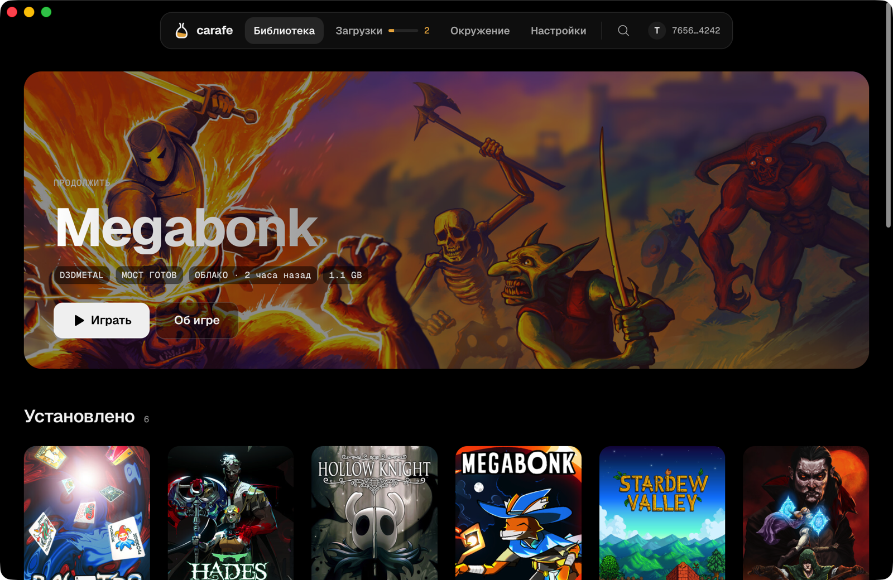
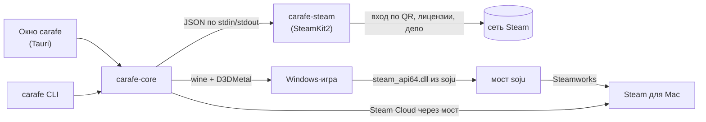

<p align="center">
  
</p>

<h1 align="center">carafe</h1>

<p align="center">Windows-игры из твоей библиотеки Steam на Mac с Apple Silicon.</p>

<p align="center">
  
</p>

## Что умеет

- **Вход в Steam по QR.** Сканируешь код приложением Steam на телефоне, пароль carafe не спрашивает и не видит. Токен входа лежит в Связке ключей macOS.
- **Вся библиотека.** Установленные игры и все купленные, с обложками из Steam. Игры без Windows-сборки видно сразу.
- **Установка куда угодно.** Несколько папок библиотек, в том числе на внешнем диске. Загрузки идут очередью: пауза, порядок, докачка после перезапуска. Игру можно перенести между папками; игры с отключённого диска остаются в списке.
- **Запуск через Wine с D3DMetal.** DirectX 11 и 12 переводятся в Metal. Перед запуском carafe применяет обходы, нужные конкретным игровым движкам.
- **Мост Steamworks.** Ачивки, статистика, лидерборды и Steam Cloud работают через Steam для Mac, второй Steam-клиент под Windows не нужен. Сейвы скачиваются из облака перед запуском и выгружаются после выхода.

Есть окно (`gui/`) и CLI с теми же возможностями.

## Что нужно

- Mac с Apple Silicon и macOS (окно собрано под macOS 13 и новее).
- Rosetta 2: `softwareupdate --install-rosetta`.
- [Steam для Mac](https://store.steampowered.com/about/), запущенный и с тем же аккаунтом: через него работают мост и Steam Cloud.
- Движок по умолчанию — [soju](https://github.com/userTrv/soju): Wine 11 из исходников CrossOver под Rosetta. carafe берёт последний релиз `engine-v*`, сверяет размер и sha256 с его `engine.json` и ставит в `engines/soju-<версия>`.
- D3DMetal из Apple Game Porting Toolkit. В архиве soju его нет: carafe подключает D3DMetal из твоей копии GPTK (`bin/soju-d3dmetal` ищет её в движке GPTK от carafe, в /Applications, в смонтированном образе, в CrossOver). Нет своей копии — `carafe engine install gptk` ставит сборку Wine с D3DMetal из GPTK 3.0 от [Gcenx](https://github.com/Gcenx/game-porting-toolkit): она источник D3DMetal и запасной движок.
- Checkout [soju](https://github.com/userTrv/soju) рядом с carafe (`../soju`) или в `CARAFE_SOJU`: из него собирается мост.
- Для сборки из исходников: Rust 1.99.1 (берётся из `rust-toolchain.toml`) и .NET SDK из `steam/global.json` для хелпера входа.

## Установка и первый запуск

Готовых сборок пока нет, carafe собирается из исходников.

```bash
git clone https://github.com/userTrv/carafe
git clone https://github.com/userTrv/soju        # рядом, для моста
cd carafe
cargo build --release                            # CLI: target/release/carafe
steam/build.sh                                   # хелпер входа carafe-steam
```

Окно:

```bash
cd gui && cargo run --release
```

При первом запуске окно открывает экран «Окружение»: что уже есть (Rosetta, движок, D3DMetal, бутылка, soju, Steam для Mac) и кнопка «Починить», которая ставит движок и создаёт бутылку. Дальше вход по QR, выбор игры, «Установить» и «Играть».

То же из терминала:

```bash
carafe engine install        # soju; без своей копии GPTK ещё: carafe engine install gptk
carafe bottle create
carafe login                 # QR в терминале
carafe game owned            # купленные игры
carafe game install <appid>  # в очередь загрузок
carafe downloads run
carafe game run <appid>
```

### Нативные macOS-игры

У многих купленных игр есть своя сборка под Mac. В библиотеке такие отмечены `MAC`, а «Установить» предлагает выбор: «Нативно для macOS» (по умолчанию) или «Через carafe (Windows)». Нативная игра ставится в ту же библиотеку (`<папка>/<appid>/`, метка `.carafe-native`), переносится и считается так же, а запускается сама, без Wine, бутылки и моста. Steamworks в ней говорит с Steam для Mac напрямую, поэтому игре со Steam API нужен запущенный Steam; облако синхронизирует он же. Уже установленные Windows-игры остаются как есть. В bash-версии `game install --native` нет (нативные игры ставят Rust-версия и carafe.app), но запустить уже поставленную нативную игру `game run` умеет.

## CLI

Полная справка: `carafe --help`. Основное:

| Команда | Что делает |
|---|---|
| `carafe engine install [gptk]` | поставить последний soju и подключить D3DMetal; `gptk` — запасной движок и источник D3DMetal |
| `carafe engine update` | поставить новый релиз soju, если вышел |
| `carafe engine status` | какие движки стоят, какой активен, подключён ли D3DMetal |
| `carafe engine use soju\|gptk` | сменить движок: бутылки сначала копируются рядом, потом `wineboot -u` новым движком |
| `carafe bottle create [NAME]` | создать префикс Wine (по умолчанию `default`) |
| `carafe bottle restore NAME [КОПИЯ]` | вернуть бутылку из резервной копии (по умолчанию свежей) |
| `carafe login`, `carafe logout`, `carafe account` | вход в Steam по QR, выход, текущий аккаунт |
| `carafe game owned` | все купленные игры аккаунта |
| `carafe game install APPID [USER] [--to DIR] [--native]` | поставить в очередь; без `USER` через вход по QR, с `USER` через steamcmd; `--native` — нативная macOS-сборка без Wine (только вход по QR) |
| `carafe game run APPID [ARGS...]` | облако вниз, мост, игра, облако вверх; нативная игра — сразу её `.app` |
| `carafe game list`, `verify`, `move APPID DIR`, `import APPID [DIR]` | установленные игры, проверка файлов, перенос, импорт depot из консоли Steam |
| `carafe library list\|add\|remove\|default\|du` | папки библиотек и место на дисках |
| `carafe downloads [list\|run\|pause\|resume\|cancel\|top APPID]` | очередь загрузок |
| `carafe bridge build\|test APPID` | собрать мост, сверить его с нативным Steam на Spacewar (480) |
| `carafe cloud status\|pull\|push APPID` | Steam Cloud вручную |
| `carafe run EXE`, `carafe wine ...` | любой .exe или wine в префиксе |

Переменные окружения:

| Переменная | Что делает |
|---|---|
| `CARAFE_BOTTLE` | префикс Wine, по умолчанию `default` |
| `CARAFE_EXE` | exe игры, если автоопределение ошиблось |
| `CARAFE_HUD=1` | Metal HUD с FPS |
| `CARAFE_BRIDGE=0` | запуск без моста, с оригинальной `steam_api64.dll` |
| `CARAFE_CLOUD=0` | `game run` не трогает Steam Cloud |
| `CARAFE_ENGINE_DIR` | свой движок, например `dist/soju-engine` из soju; главнее выбранного `engine use` |
| `CARAFE_SOJU` | checkout soju, по умолчанию `../soju` |
| `CARAFE_STEAM_HELPER` | свой `carafe-steam`, по умолчанию `steam/dist/<rid>/` |
| `CARAFE_HOME` | где всё хранится, по умолчанию `~/Library/Application Support/carafe` |

`bin/carafe` — прежняя версия на bash с частью команд (без входа по QR, библиотек и очереди). Данные у неё общие с Rust-версией, команды `engine` и `bottle restore` ведут себя одинаково.

### Движки

Активный движок записан в `engines/current` (имя каталога в `engines/`); `CARAFE_ENGINE_DIR` главнее. Новый пользователь получает soju. Кто уже играл на GPTK (есть `engines/gptk-3.0-3` и бутылки), остаётся на нём, пока сам не скажет `carafe engine use soju`; `engine status` и «Окружение» в окне предлагают перейти.

Смена движка ничего не удаляет. Перед `wineboot -u` новым движком каждая бутылка копируется в `bottles/<имя>.backup-<дата>` (на APFS это клон: мгновенно и без места). Если в бутылке что-то запущено, смена отказывает. Не обновилась — бутылки возвращаются из копий, движок остаётся прежним. Если новый движок заводит другого пользователя Windows, сейвы (AppData, Documents, Saved Games) копируются к нему. Откат: `carafe engine use gptk`, а бутылку целиком — `carafe bottle restore default` (заменённая уходит в `<имя>.replaced-<дата>`).

## Как устроено



- **carafe-core** (`crates/carafe-core`) знает всё о библиотеках, очереди, движке, бутылках, облаке и запуске. На нём стоят CLI (`crates/carafe-cli`) и окно (`gui/`).
- **carafe-steam** (`steam/`) входит в Steam по QR, отдаёт список купленных игр и качает депо. Пароля не принимает; токен получает только через stdin. Протокол: `steam/PROTOCOL.md`.
- **soju** даёт мост: заглушка `steam_api64.dll` в игре передаёт вызовы Steamworks нативному хелперу, а тот говорит с запущенным Steam для Mac от имени игры. Через тот же хелпер carafe синхронизирует Steam Cloud по правилам Auto-Cloud игры; проигравшая при конфликте версия уходит в `backups/<appid>/<время>/`.
- Данные лежат в `~/Library/Application Support/carafe`: движки, бутылки, игры встроенной библиотеки, очередь `downloads.vdf`, список папок `libraryfolders.vdf`.

## Разработка

```bash
cargo fmt --all --check && cargo clippy --all-targets -- -D warnings && cargo test   # ядро и CLI
```

Окно (`gui/`) собирается отдельно: интерфейс на HTML, CSS и JS без сборщика (`gui/ui`), логика на Rust (`gui/src-tauri`). Демо-режим ничего не запускает и не ходит в Steam:

```bash
cd gui
CARAFE_GUI_BACKEND=mock cargo run                                   # демо-данные
CARAFE_GUI_BACKEND=mock CARAFE_MOCK_STEAM=in cargo run              # уже вошёл, вся библиотека
CARAFE_GUI_BACKEND=mock CARAFE_MOCK=fresh cargo run                 # первый запуск
CARAFE_GUI_BACKEND=mock CARAFE_GUI_ROUTE=game/3405340 cargo run     # сразу нужный экран
cargo clippy --all-targets -- -D warnings && cargo test
```

Экраны, переменные и устройство окна: [gui/README.md](gui/README.md). Правила облика: [gui/DESIGN.md](gui/DESIGN.md).

## Ограничения

- Только Apple Silicon и только Windows-сборки игр из Steam.
- Игры с античитом уровня ядра (EAC, BattlEye и подобные) не запустятся.
- Без запущенного Steam для Mac нет ачивок, лидербордов и Steam Cloud. Файлы облака, зашифрованные Steam, carafe не трогает.
- Готовых сборок `.app` пока нет.

> **Неофициальный клиент Steam.** Вход и загрузка идут через `carafe-steam` на [SteamKit2](https://github.com/SteamRE/SteamKit). Valve такие клиенты терпит, но официально не поддерживает: протокол может поменяться, а аккаунт формально подпадает под соглашение подписчика Steam. carafe не связан с Valve, Apple или CodeWeavers.

## Лицензия

MIT, см. [LICENSE](LICENSE). Сторонние части (движок, мост soju, Steamworks SDK, D3DMetal, SteamKit2, шрифты, иконки) и их лицензии перечислены в [NOTICE.md](NOTICE.md).
